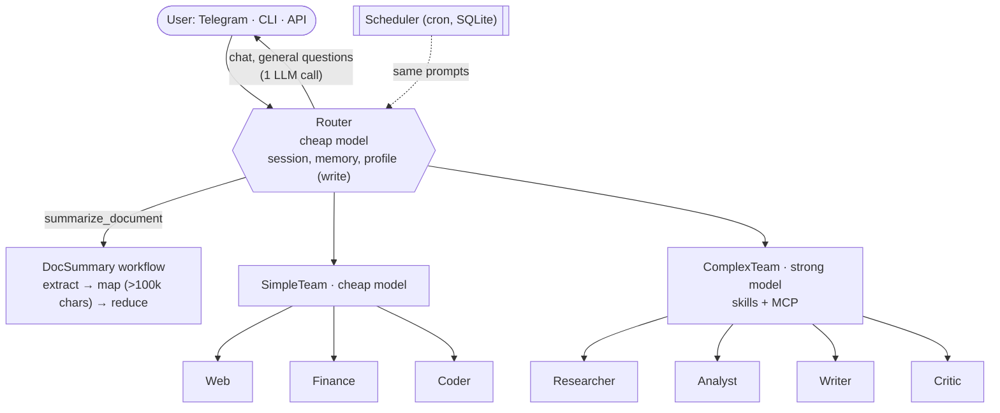

<div align="center">

# 🤖 PicoBot

**Multi-agent personal assistant built on Agno 3 — Telegram, CLI and REST API**

🇬🇧 English · 🇮🇹 [Italiano](README_IT.md)

[](pyproject.toml)
[](LICENSE)
[](https://www.python.org/)
[](https://github.com/agno-agi/agno)
[](https://fastapi.tiangolo.com/)
[](https://core.telegram.org/bots)
[](docker-compose.yaml)
[](https://modelcontextprotocol.io/)
[](https://openrouter.ai/)
[](https://www.sqlite.org/)
[](https://github.com/jumping2000/picobot/actions/workflows/release_ci-cd.yml)
[](https://github.com/jumping2000/picobot/pkgs/container/picobot)
[](https://github.com/jumping2000/picobot/commits/main)
[](https://github.com/jumping2000/picobot)

</div>

---

PicoBot is a self-hosted personal assistant. A cheap **router** model answers simple questions on its own and
delegates the rest to one of three paths: a fast **SimpleTeam** (web search, market quotes, small Python scripts),
a powerful **ComplexTeam** (deep research, analysis, Word/PowerPoint/Excel documents via skills and MCP) or a
**document summary workflow**. It remembers a per-user profile, recurring projects and people, and runs scheduled
tasks with cron.

> [!NOTE]
> The agents' prompts are written in Italian, but PicoBot answers in the user's language. A few commands keep their
> Italian name (e.g. `/riassumi` = summarize).

## ✨ Features

| | |
|---|---|
| 🧭 **Cost-aware routing** | Cheap model for routing and simple tasks, strong model only for the ComplexTeam |
| 👥 **Two agent teams** | SimpleTeam (Web, Finance, Coder) and ComplexTeam (Researcher, Analyst, Writer, Critic) |
| 📄 **Office documents** | Creates `.docx`, `.pptx`, `.xlsx` files through installable [Agent Skills](docs/en/skills.md) |
| 🔌 **MCP servers** | Any MCP server (stdio or HTTP) in Claude Desktop format, shared by the ComplexTeam |
| 🎤 **Voice messages** | Telegram voice notes and audio files transcribed locally (faster-whisper on CPU, Italian and English), then executed like typed text — see [voice](docs/en/voice.md) |
| 📚 **Document summaries** | PDF, DOCX, TXT, MD, CSV, JSON, LOG; parallel map-reduce above 100,000 characters |
| 🧠 **Memory & profile** | Memories, structured profile (language, time zone, format, tickers) and entities, private per user |
| ⏰ **Scheduler** | Recurring cron tasks; the result goes back to the channel that created them |
| 🛡️ **Human-in-the-loop** | Generated code always runs **after your confirmation**, in a separate, resource-limited process |
| 💬 **Three channels** | Telegram (confirm buttons), interactive CLI, REST API with bearer tokens and optional TLS |

## 🏗️ Architecture



More details in [docs/en/architecture.md](docs/en/architecture.md).

## 🚀 Quick start

> [!IMPORTANT]
> You need an [OpenRouter](https://openrouter.ai/) (or OpenAI-compatible) API key and at least one channel:
> a Telegram bot token or an API token.

```bash
git clone https://github.com/jumping2000/picobot.git && cd picobot
cp .env.example .env            # set OPENROUTER_API_KEY, TELEGRAM_* and/or API_TOKENS
mkdir -p data workspace skills && sudo chown -R 1000 data workspace skills
docker compose up -d --build
```

> [!TIP]
> Prefer a prebuilt image? Replace `build: .` with `image: ghcr.io/jumping2000/picobot:latest` in
> `docker-compose.yaml` (linux/amd64 and linux/arm64). See [getting-started](docs/en/getting-started.md#prebuilt-image).

- **Telegram**: write to your bot, then `/help`.
- **CLI**: `docker compose exec -it picobot python -m picobot cli`
- **API**: `curl localhost:8000/health`; interactive docs at `http://localhost:8000/docs`

```bash
curl -X POST localhost:8000/v1/chat -H "Authorization: Bearer $TOKEN" -H "content-type: application/json" \
     -d '{"message":"create a one-page docx about AAPL quotes", "approve_code": true}'
curl -OJ localhost:8000/v1/files/<id> -H "Authorization: Bearer $TOKEN"
```

Full guide: [docs/en/getting-started.md](docs/en/getting-started.md).

## 🎯 Explicit routing

The router chooses by itself, but you can pick the path:

| Channel | SimpleTeam | ComplexTeam | Summary |
|---|---|---|---|
| Telegram / CLI | `/simple <request>` | `/complex <request>` | `/riassumi [instructions]` or `/riassumi <link>` |
| REST API | `"target": "simple"` | `"target": "complex"` | `POST /v1/summarize` |
| Natural language | "use the SimpleTeam to…" | "use the ComplexTeam to…" | "summarize this document" |

> [!TIP]
> Commands bypass the router, so they cost fewer calls and always take the path you chose. Natural-language
> requests are honored by the router, but with the cheap model this is not 100% guaranteed.

## 💰 Cost profile

Measured with the simulated model used in the tests:

| Request | LLM calls |
|---|---|
| "hello" | 1 cheap call (~2,900 tokens) |
| Quote, web search, script | ~5–6 cheap calls; 2 fewer with `/simple` |
| Office document | ~9, of which ~7 on the strong model |
| Summary of a document up to 100,000 characters | 1 workflow call + 2 router calls; only 1 with `/riassumi` |

## 🔐 Security at a glance

> [!WARNING]
> Generated code has **unrestricted network access** and runs as the bot's user (it can read `data/`). The real
> isolation boundary is the container. **MCP tools do not ask for confirmation**: configure only trusted servers.

- Telegram is **fail-closed**: without authorized IDs, the bot does not start.
- API tokens are compared in constant time; the API binds to `127.0.0.1` by default; direct HTTPS is supported.
- Code runs only after confirmation, at most 6 runs per request, with timeout, CPU/RAM/file-size limits and a
  stripped environment (no API keys).
- Delivered files can only come from `workspace/outputs/`; Agno telemetry is **off** by default.

Details: [docs/en/security.md](docs/en/security.md).

## 📖 Documentation

| Topic | English | Italiano |
|---|---|---|
| Overview | [index](docs/en/index.md) | [indice](docs/it/index.md) |
| Installation & first run | [getting-started](docs/en/getting-started.md) | [per iniziare](docs/it/getting-started.md) |
| Configuration (`.env`) | [configuration](docs/en/configuration.md) | [configurazione](docs/it/configuration.md) |
| Architecture | [architecture](docs/en/architecture.md) | [architettura](docs/it/architecture.md) |
| Telegram & CLI | [channels](docs/en/channels.md) | [canali](docs/it/channels.md) |
| REST API | [api](docs/en/api.md) | [api](docs/it/api.md) |
| Skills & dependencies | [skills](docs/en/skills.md) | [skill](docs/it/skills.md) |
| MCP servers | [mcp](docs/en/mcp.md) | [mcp](docs/it/mcp.md) |
| Memory, profile, entities | [memory](docs/en/memory.md) | [memoria](docs/it/memory.md) |
| Voice messages (STT) | [voice](docs/en/voice.md) | [vocali](docs/it/voice.md) |
| Scheduled tasks | [scheduler](docs/en/scheduler.md) | [scheduler](docs/it/scheduler.md) |
| Security | [security](docs/en/security.md) | [sicurezza](docs/it/security.md) |
| Development & tests | [development](docs/en/development.md) | [sviluppo](docs/it/development.md) |
| Troubleshooting | [troubleshooting](docs/en/troubleshooting.md) | [risoluzione problemi](docs/it/troubleshooting.md) |

## 🧪 Tests

```bash
uv run --group dev pytest tests     # fake LLM, no API key needed
```

Manual acceptance checklist: [docs/en/manual-qa.md](docs/en/manual-qa.md). Changelog: [CHANGELOG.md](CHANGELOG.md).
CI runs the suite on Python 3.11–3.13 and publishes the Docker image on every release:
see [development → CI/CD](docs/en/development.md#cicd).

## 🧰 Tech stack

[Agno 3](https://github.com/agno-agi/agno) · [python-telegram-bot 21](https://python-telegram-bot.org/) ·
[FastAPI](https://fastapi.tiangolo.com/) + Uvicorn · [APScheduler 3](https://apscheduler.readthedocs.io/) ·
SQLite · [yfinance](https://github.com/ranaroussi/yfinance) · [DDGS](https://pypi.org/project/ddgs/) ·
[MCP](https://modelcontextprotocol.io/) · pypdf · python-docx · [uv](https://docs.astral.sh/uv/)

## 📜 License

Released under the [MIT License](LICENSE).

> [!NOTE]
> The license covers PicoBot's code only. Skills you install in `skills/` (e.g. the sample `docx`, `pptx`, `xlsx`)
> keep their own licenses and are not part of this repository.
