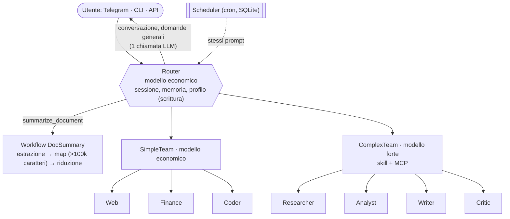

<div align="center">

# 🤖 PicoBot

**Assistente personale multi-agente basato su Agno 3 — Telegram, CLI e API REST**

🇮🇹 Italiano · 🇬🇧 [English](README.md)

[](pyproject.toml)
[](LICENSE)
[](https://www.python.org/)
[](https://github.com/agno-agi/agno)
[](https://fastapi.tiangolo.com/)
[](https://core.telegram.org/bots)
[](compose.yaml)
[](https://modelcontextprotocol.io/)
[](https://openrouter.ai/)
[](https://www.sqlite.org/)
[](https://github.com/jumping2000/picobot/actions/workflows/release_ci-cd.yml)
[](https://github.com/jumping2000/picobot/pkgs/container/picobot)
[](https://github.com/jumping2000/picobot/commits/main)
[](https://github.com/jumping2000/picobot)

</div>

---

PicoBot è un assistente personale self-hosted. Un **router** su modello economico risponde da solo alle domande
semplici e delega il resto a una di tre strade: lo **SimpleTeam** veloce (ricerca web, quotazioni, piccoli script
Python), il **ComplexTeam** potente (ricerca approfondita, analisi, documenti Word/PowerPoint/Excel tramite skill e
MCP) o il **workflow dei riassunti**. Ricorda per ogni utente un profilo, i progetti e le persone ricorrenti, ed
esegue task programmati con cron.

## ✨ Funzionalità

| | |
|---|---|
| 🧭 **Instradamento attento ai costi** | Modello economico per router e compiti semplici, modello forte solo per il ComplexTeam |
| 👥 **Due team di agenti** | SimpleTeam (Web, Finance, Coder) e ComplexTeam (Researcher, Analyst, Writer, Critic) |
| 📄 **Documenti Office** | Crea file `.docx`, `.pptx`, `.xlsx` con [Agent Skills](docs/it/skills.md) installabili |
| 🔌 **Server MCP** | Qualsiasi server MCP (stdio o HTTP) in formato Claude Desktop, condiviso dal ComplexTeam |
| 🎤 **Messaggi vocali** | Note vocali e file audio Telegram trascritti in locale (faster-whisper su CPU, italiano e inglese) ed eseguiti come testo scritto — vedi [vocali](docs/it/voice.md) |
| 📚 **Riassunti** | Documenti (PDF, DOCX, TXT, MD, CSV, JSON, LOG; map-reduce in parallelo oltre 100.000 caratteri) e pagine web (`/riassumi <link>`) |
| 🌐 **Ricerche aggiornate** | Gli agenti conoscono data e ora correnti; la ricerca web interroga un motore alla volta (prima DuckDuckGo) e passa al successivo solo se non trova nulla |
| 🧠 **Memoria e profilo** | Memorie, profilo strutturato (lingua, fuso, formato, titoli) ed entità, privati per utente |
| ⏰ **Scheduler** | Task ricorrenti, con cron o a parole ("ogni giorno feriale alle 8…"); l'esito torna sul canale che li ha creati |
| 🧩 **Skill da chat** | Gli amministratori installano e rimuovono skill da Telegram o dalla CLI (`/skill_add <link>`, uno `.zip` allegato, `/skill_remove`) |
| ⚙️ **Configurazione YAML** | Segreti in `.env`, tutto il resto in `config/config.yaml`, diviso in blocchi e controllato all'avvio |
| 🔎 **Traccia delle richieste** | Opzionale: `/trace` mostra team, agenti e tool attraversati dall'ultima richiesta |
| 🛡️ **Human-in-the-loop** | Il codice generato gira **solo dopo la tua conferma**, in un processo separato e con limiti di risorse |
| 💬 **Tre canali** | Telegram (bottoni di conferma), CLI interattiva, API REST con token bearer e TLS opzionale |

## 🏗️ Architettura



Dettagli in [docs/it/architecture.md](docs/it/architecture.md).

## 🚀 Avvio rapido

> [!IMPORTANT]
> Servono una chiave API [OpenRouter](https://openrouter.ai/) (o compatibile OpenAI) e almeno un canale:
> un token di bot Telegram o un token API.

```bash
git clone https://github.com/jumping2000/picobot.git && cd picobot
cp .env.example .env            # imposta OPENROUTER_API_KEY, TELEGRAM_* e/o API_TOKENS (e ADMIN_USER_IDS)
cp config/config_example.yaml config/config.yaml   # opzionale: tutte le altre impostazioni
mkdir -p data workspace skills && sudo chown -R 1000 data workspace skills
docker compose up -d            # immagini pronte da ghcr.io (linux/amd64, linux/arm64)
```

> [!TIP]
> I file compose sono due: `compose.yaml` usa le immagini pronte, `compose-build.yaml` le costruisce in locale
> (serve se una skill richiede altre librerie): `docker compose -f compose-build.yaml up -d --build`. In entrambi
> la trascrizione dei vocali (`stt`) parte solo con il suo profilo: aggiungi `--profile stt`, oppure
> `COMPOSE_PROFILES=stt` in `.env`. Vedi [per iniziare](docs/it/getting-started.md#immagini-pronte-o-build-locale).

- **Telegram**: scrivi al tuo bot, poi `/help`.
- **CLI**: `docker compose exec -it picobot python -m picobot cli`
- **API**: `curl localhost:8000/health`; documentazione interattiva su `http://localhost:8000/docs`

```bash
curl -X POST localhost:8000/v1/chat -H "Authorization: Bearer $TOKEN" -H "content-type: application/json" \
     -d '{"message":"crea un docx di una pagina sulle quotazioni di AAPL", "approve_code": true}'
curl -OJ localhost:8000/v1/files/<id> -H "Authorization: Bearer $TOKEN"
```

Guida completa: [docs/it/getting-started.md](docs/it/getting-started.md).

## 🎯 Richiamo esplicito

Il router sceglie da solo, ma puoi indicare tu la strada:

| Canale | SimpleTeam | ComplexTeam | Riassunto |
|---|---|---|---|
| Telegram / CLI | `/simple <richiesta>` | `/complex <richiesta>` | `/riassumi [istruzioni]` o `/riassumi <link>` |
| API REST | `"target": "simple"` | `"target": "complex"` | `POST /v1/summarize` |
| Linguaggio naturale | "usa lo SimpleTeam per…" | "usa il ComplexTeam per…" | "riassumi questo documento" |

> [!TIP]
> I comandi saltano il router: costano meno chiamate e seguono sempre la strada scelta. Le richieste in linguaggio
> naturale vengono rispettate dal router, ma con il modello economico non è garantito al 100%.

## 💰 Costi

Misurati con il modello simulato dei test:

| Richiesta | Chiamate LLM |
|---|---|
| "ciao" | 1 economica (~2.900 token) |
| Quotazione, ricerca web, script | ~5-6 economiche; 2 in meno con `/simple` |
| Documento Office | ~9, di cui ~7 sul modello forte |
| Riassunto di un documento fino a 100.000 caratteri | 1 del workflow + 2 del router; solo 1 con `/riassumi` |

## 🔐 Sicurezza in breve

> [!WARNING]
> Il codice generato ha **accesso libero alla rete** e gira con lo stesso utente del bot (può leggere `data/`).
> L'isolamento reale è il container. **I tool MCP non chiedono conferma**: configura solo server fidati.

- Telegram è **fail-closed**: senza ID autorizzati il bot non parte.
- Token API confrontati a tempo costante; API su `127.0.0.1` di default; HTTPS diretto supportato.
- Il codice gira solo dopo conferma, massimo 6 esecuzioni per richiesta, con timeout, limiti CPU/RAM/dimensione
  file e ambiente ripulito (nessuna chiave API).
- I file consegnati escono solo da `workspace/outputs/`; la telemetria di Agno è **spenta** di default.
- Le skill si installano da chat solo da amministratori (`ADMIN_USER_IDS`, vuota = spento), solo da `https://`,
  mai dalla rete locale. `./skills` è scrivibile dal container, anche dal codice generato confermato.

Dettagli: [docs/it/security.md](docs/it/security.md).

## 📖 Documentazione

| Argomento | Italiano | English |
|---|---|---|
| Panoramica | [indice](docs/it/index.md) | [index](docs/en/index.md) |
| Installazione e primo avvio | [per iniziare](docs/it/getting-started.md) | [getting-started](docs/en/getting-started.md) |
| Configurazione (`.env`, `config.yaml`) | [configurazione](docs/it/configuration.md) | [configuration](docs/en/configuration.md) |
| Architettura | [architettura](docs/it/architecture.md) | [architecture](docs/en/architecture.md) |
| Telegram e CLI | [canali](docs/it/channels.md) | [channels](docs/en/channels.md) |
| API REST | [api](docs/it/api.md) | [api](docs/en/api.md) |
| Skill e dipendenze | [skill](docs/it/skills.md) | [skills](docs/en/skills.md) |
| Server MCP | [mcp](docs/it/mcp.md) | [mcp](docs/en/mcp.md) |
| Memoria, profilo, entità | [memoria](docs/it/memory.md) | [memory](docs/en/memory.md) |
| Messaggi vocali (STT) | [vocali](docs/it/voice.md) | [voice](docs/en/voice.md) |
| Task programmati | [scheduler](docs/it/scheduler.md) | [scheduler](docs/en/scheduler.md) |
| Sicurezza | [sicurezza](docs/it/security.md) | [security](docs/en/security.md) |
| Sviluppo e test | [sviluppo](docs/it/development.md) | [development](docs/en/development.md) |
| Risoluzione problemi | [risoluzione problemi](docs/it/troubleshooting.md) | [troubleshooting](docs/en/troubleshooting.md) |

## 🧪 Test

```bash
uv run --group dev pytest tests     # LLM finto, nessuna chiave necessaria
```

Collaudo manuale: [docs/it/manual-qa.md](docs/it/manual-qa.md). Changelog (in inglese): [CHANGELOG.md](CHANGELOG.md).
La CI esegue la suite su Python 3.11-3.13 e pubblica l'immagine Docker a ogni release:
vedi [sviluppo → CI/CD](docs/it/development.md#cicd).

## 🧰 Stack tecnologico

[Agno 3](https://github.com/agno-agi/agno) · [python-telegram-bot 21](https://python-telegram-bot.org/) ·
[FastAPI](https://fastapi.tiangolo.com/) + Uvicorn · [APScheduler 3](https://apscheduler.readthedocs.io/) ·
SQLite · [yfinance](https://github.com/ranaroussi/yfinance) · [DDGS](https://pypi.org/project/ddgs/) ·
[MCP](https://modelcontextprotocol.io/) · pypdf · python-docx · trafilatura · PyYAML · [uv](https://docs.astral.sh/uv/)

## 📜 Licenza

Distribuito con [licenza MIT](LICENSE).

> [!NOTE]
> La licenza copre solo il codice di PicoBot. Le skill installate in `skills/` (es. quelle di esempio `docx`,
> `pptx`, `xlsx`) mantengono le proprie licenze e non fanno parte di questo repository.
