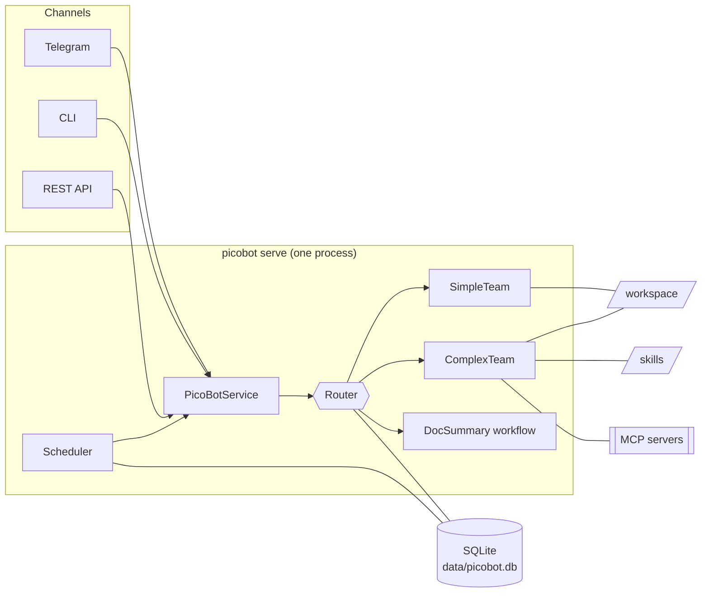
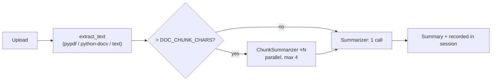

# Architecture

🇬🇧 English · 🇮🇹 [Italiano](../it/architecture.md) · ⬅️ [Index](index.md)

## Overview



The channels never touch Agno directly: they talk to `PicoBotService`
([`service.py`](../../src/picobot/service.py)), a thin async facade over the router, the summary workflow and the
scheduler.

## Agents and teams

```
Router (coordinate team, CHEAP model; session, memories, profile and entities in WRITE mode)
 |- answers chat and general questions by itself ................ 1 LLM call
 |- summarize_document -> DocSummary workflow (uploaded document, cheap model)
 |- SimpleTeam (cheap model; profile read-only)
 |    |- Web       web and news search (DDGS, one engine at a time)
 |    |- Finance   yfinance (sees the tickers you follow)
 |    '- Coder     Python programs (with confirmation), text files, file delivery
 '- ComplexTeam (STRONG model for every member; skills and MCP; profile read-only)
      |- Researcher  in-depth web research
      |- Analyst     reasons, analyses, computes (also with code); hands material to the Writer
      |- Writer      writes and produces the final result (text; Word/PowerPoint/Excel with code) and delivers it
      '- Critic      reviews the draft (optional, memory.enable_critic)
```

### Tools per agent

| Agent | Tools |
|---|---|
| Router | `summarize_document`, memory (`add_memory`…), `update_profile`, `remember_about` |
| Web | `web_search`, `search_news` (DDGS in cascade, see below) |
| Finance | yfinance (price, company info, history, analyst recommendations, news) |
| Coder | `save_python_file`, `run_python`, `save_text_file`, `deliver_file` |
| Researcher | `web_search`, `search_news`, MCP, skills |
| Analyst | yfinance, `save_python_file`, `run_python`, `run_node`, `read_document`, MCP, skills — **no** `deliver_file` |
| Writer | `save_text_file`, `save_python_file`, `run_python`, `run_node`, `deliver_file`, `read_document`, MCP, skills |
| Critic | MCP, skills (no code) |

The Analyst cannot deliver files on purpose: it prepares the content, the Writer produces and delivers the result.

### Date and time, web search, tickers

- **Current date and time.** The router and every team and agent get the current date and time in their system
  prompt, in the `scheduler.timezone` time zone (a few tokens per call). So "today's news" really searches today,
  not around the model's training date; Coder and Analyst do not run code to find out the date.
- **Cascading web search** ([`tools/websearch.py`](../../src/picobot/tools/websearch.py)). Web and Researcher ask
  one engine at a time and move to the next only when the previous one finds nothing: DuckDuckGo, Yahoo,
  Startpage, Mojeek for the web; DuckDuckGo, Bing, Yahoo for news. When none finds anything the agent gets a
  message, not an error. The region of the results is `web.region`.
- **Yahoo tickers.** Finance and Analyst have in their instructions the symbols of the main indices (FTSE MIB =
  `FTSEMIB.MI`, S&P 500 = `^GSPC`, DAX = `^GDAXI`…), the exchange suffixes (`.MI`, `.DE`, `.PA`, `.L`, `.AS`) and
  the rule not to try symbols at random when one is not found.

### Routing rules

The router prompt ([`prompts.py`](../../src/picobot/prompts.py)) always picks the **cheapest** path:

| Request | Path |
|---|---|
| Chat, explanations, general questions | Router answers directly |
| Quotes, market data, web search, small Python programs, simple text files | SimpleTeam |
| Word/PowerPoint/Excel/PDF documents, tasks covered by a skill, multi-step research + analysis + report | ComplexTeam |
| Uploaded document with no instruction or a summary request | `summarize_document` |
| Uploaded document with another request (e.g. "make a presentation from this PDF") | ComplexTeam (`read_document`) |
| Explicit user choice ("use the ComplexTeam…") | The requested path |

Explicit commands (`/simple`, `/complex`, `/riassumi`, API `target`) skip the router entirely. The exchange is then
appended to the router session **without LLM calls**, so follow-up questions keep the context.

## DocSummary workflow



Text extraction is deterministic (no LLM). Scanned PDFs without a text layer are rejected (OCR is not included).

## Request lifecycle

1. The channel builds a `RunCtx` ([`context.py`](../../src/picobot/context.py)): user, channel, confirmation
   callback, optional uploaded document. It travels in a `ContextVar`, so tools read it without depending on Agno.
2. `PicoBotService.ask()` refreshes skills (hot reload), then runs the router or the requested team.
3. Code tools call the confirmation callback before every execution; `deliver_file` adds validated files to
   `RunCtx.outputs`.
4. The channel sends the text and the delivered files (Telegram: documents; CLI: paths; API: download IDs).

## Data layout

| Path | Contents |
|---|---|
| `data/picobot.db` | Agno sessions and runs, memories, profile, entities, `picobot_schedules` table |
| `data/telegram_state.pkl` | python-telegram-bot persistence (chat session IDs) |
| `data/inbox/` | Uploaded documents, **deleted** right after processing |
| `data/outbox/<hash(user)>/<id>/` | API copies of delivered files, purged after `OUTBOX_TTL_H` |
| `workspace/scripts/` | Saved scripts and temporary `_run-*.py/js` files (deleted after the run) |
| `workspace/outputs/` | The only folder from which files can be delivered |

## Source map

| Module | Role |
|---|---|
| `__main__.py` | Entry point (`picobot serve`, `cli`, `skills`) and startup checks |
| `config.py` | Settings: `.env`, environment and block-based `config/config.yaml`, with the YAML checks |
| `runner.py` | Starts channels, API server and scheduler; graceful shutdown |
| `service.py` | Facade: `ask`, `summarize`, `memory_report`, `forget` |
| `team.py` | Router construction |
| `agents.py` | SimpleTeam, ComplexTeam and their members |
| `prompts.py` | All agent instructions (text only) |
| `storage.py` | SQLite DB, memory manager, LearningMachine (profile + entities) |
| `skills.py`, `skills_cli.py` | Skill registry with hot reload; admin CLI and installation (also from chat) |
| `mcp_loader.py` | MCP connections |
| `scheduler.py` | Cron tasks (APScheduler + SQLite) |
| `documents.py`, `workflows/doc_summary.py` | Text extraction and summary workflow |
| `web.py` | Page and file downloads with the local-network checks (`/riassumi <link>`, `/skill_add`) |
| `trace.py`, `stt.py` | Request trace (`/trace`); transcription service client |
| `tools/sandbox.py`, `tools/files.py`, `tools/documents.py` | Code execution, file delivery, document tools |
| `tools/websearch.py`, `tools/schedule.py` | Cascading web search; scheduled tasks requested in plain words |
| `channels/telegram.py`, `cli.py`, `api.py`, `common.py` | Channels and shared helpers |
