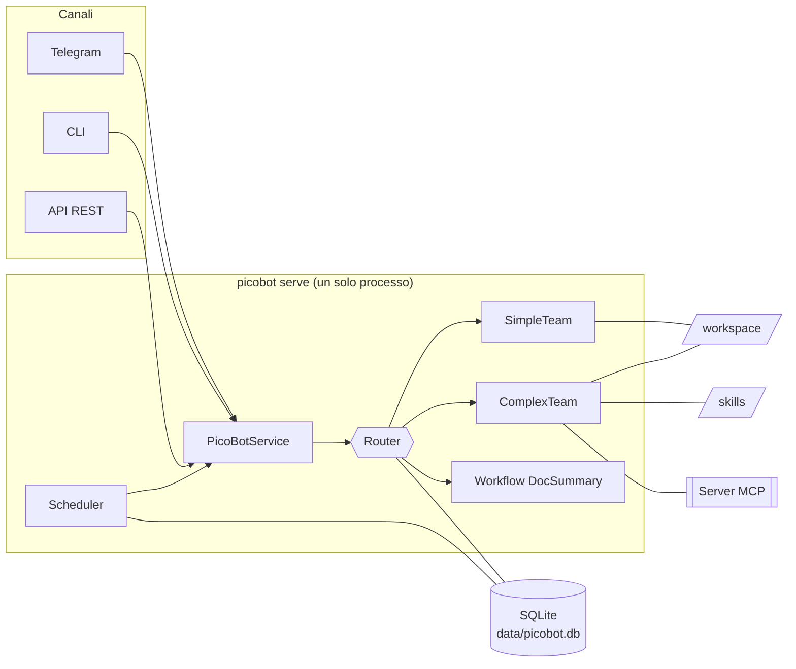
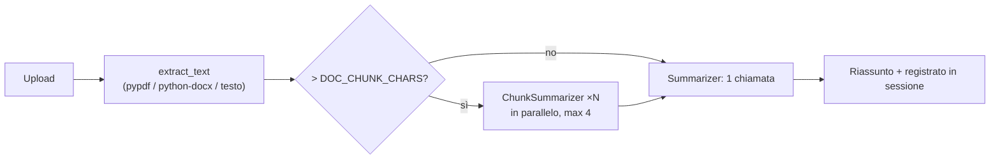

# Architettura

🇮🇹 Italiano · 🇬🇧 [English](../en/architecture.md) · ⬅️ [Indice](index.md)

## Panoramica



I canali non toccano mai Agno direttamente: parlano con `PicoBotService`
([`service.py`](../../src/picobot/service.py)), una facciata async sopra router, workflow dei riassunti e scheduler.

## Agenti e team

```
Router (Team coordinate, modello ECONOMICO; sessione, memorie, profilo ed entita' IN SCRITTURA)
 |- risponde da solo a conversazione e domande generali ...... 1 chiamata LLM
 |- summarize_document -> workflow DocSummary (documento caricato, modello economico)
 |- SimpleTeam (modello economico; profilo in sola lettura)
 |    |- Web       ricerca web (DuckDuckGo)
 |    |- Finance   yfinance (vede i titoli seguiti)
 |    '- Coder     programmi Python (con conferma), file di testo, consegna file
 '- ComplexTeam (modello FORTE per tutti i membri; skill e MCP; profilo in sola lettura)
      |- Researcher  ricerca web approfondita
      |- Analyst     ragiona, analizza, calcola (anche con codice); passa il materiale al Writer
      |- Writer      scrive e produce il risultato finale (testo; Word/PowerPoint/Excel con codice) e lo consegna
      '- Critic      rivede la bozza (opzionale, ENABLE_CRITIC)
```

### Tool per agente

| Agente | Tool |
|---|---|
| Router | `summarize_document`, memoria (`add_memory`…), `update_profile`, `remember_about` |
| Web | DuckDuckGo |
| Finance | yfinance (prezzo, info società, storico, raccomandazioni analisti, news) |
| Coder | `save_python_file`, `run_python`, `save_text_file`, `deliver_file` |
| Researcher | DuckDuckGo, MCP, skill |
| Analyst | yfinance, `save_python_file`, `run_python`, `run_node`, `read_document`, MCP, skill — **niente** `deliver_file` |
| Writer | `save_text_file`, `save_python_file`, `run_python`, `run_node`, `deliver_file`, `read_document`, MCP, skill |
| Critic | MCP, skill (niente codice) |

L'Analyst non può consegnare file per scelta: prepara il contenuto, il Writer produce e consegna il risultato.

### Regole di instradamento

Il prompt del router ([`prompts.py`](../../src/picobot/prompts.py)) sceglie sempre la strada **più economica**:

| Richiesta | Strada |
|---|---|
| Conversazione, spiegazioni, domande generali | Risponde il router |
| Quotazioni, dati di mercato, ricerche web, piccoli programmi Python, file di testo semplici | SimpleTeam |
| Documenti Word/PowerPoint/Excel/PDF, compiti coperti da una skill, ricerca + analisi + report in più passi | ComplexTeam |
| Documento caricato senza istruzioni o con richiesta di riassunto | `summarize_document` |
| Documento caricato con un'altra richiesta (es. "fammi una presentazione da questo PDF") | ComplexTeam (`read_document`) |
| Scelta esplicita dell'utente ("usa il ComplexTeam…") | La strada richiesta |

I comandi espliciti (`/simple`, `/complex`, `/riassumi`, `target` dell'API) saltano del tutto il router. Lo scambio
viene poi aggiunto alla sessione del router **senza chiamate LLM**, così le domande successive hanno il contesto.

## Workflow DocSummary



L'estrazione del testo è deterministica (nessun LLM). I PDF scansionati senza livello di testo vengono rifiutati
(l'OCR non è incluso).

## Ciclo di una richiesta

1. Il canale costruisce un `RunCtx` ([`context.py`](../../src/picobot/context.py)): utente, canale, callback di
   conferma, eventuale documento caricato. Viaggia in un `ContextVar`, così i tool lo leggono senza dipendere da Agno.
2. `PicoBotService.ask()` aggiorna le skill (ricarica a caldo), poi esegue il router o il team richiesto.
3. I tool di codice chiamano la callback di conferma prima di ogni esecuzione; `deliver_file` aggiunge i file
   validati a `RunCtx.outputs`.
4. Il canale invia il testo e i file consegnati (Telegram: documenti; CLI: percorsi; API: id di download).

## Dati

| Percorso | Contenuto |
|---|---|
| `data/picobot.db` | Sessioni e run di Agno, memorie, profilo, entità, tabella `picobot_schedules` |
| `data/telegram_state.pkl` | Persistenza di python-telegram-bot (id di sessione delle chat) |
| `data/inbox/` | Documenti caricati, **cancellati** subito dopo l'elaborazione |
| `data/outbox/<hash(utente)>/<id>/` | Copie per l'API dei file consegnati, eliminate dopo `OUTBOX_TTL_H` |
| `workspace/scripts/` | Script salvati e file temporanei `_run-*.py/js` (cancellati dopo l'esecuzione) |
| `workspace/outputs/` | L'unica cartella da cui si possono consegnare file |

## Mappa dei sorgenti

| Modulo | Ruolo |
|---|---|
| `__main__.py` | Punto d'ingresso (`picobot serve`, `cli`, `skills`) e controlli all'avvio |
| `runner.py` | Avvia canali, server API e scheduler; arresto ordinato |
| `service.py` | Facciata: `ask`, `summarize`, `memory_report`, `forget` |
| `team.py` | Costruzione del router |
| `agents.py` | SimpleTeam, ComplexTeam e i loro membri |
| `prompts.py` | Tutte le istruzioni degli agenti (solo testo) |
| `storage.py` | DB SQLite, memory manager, LearningMachine (profilo + entità) |
| `skills.py`, `skills_cli.py` | Registro delle skill con ricarica a caldo; CLI di amministrazione |
| `mcp_loader.py` | Connessioni MCP |
| `scheduler.py` | Task cron (APScheduler + SQLite) |
| `documents.py`, `workflows/doc_summary.py` | Estrazione del testo e workflow dei riassunti |
| `tools/sandbox.py`, `tools/files.py`, `tools/documents.py` | Esecuzione codice, consegna file, tool sui documenti |
| `channels/telegram.py`, `cli.py`, `api.py`, `common.py` | Canali e funzioni condivise |
